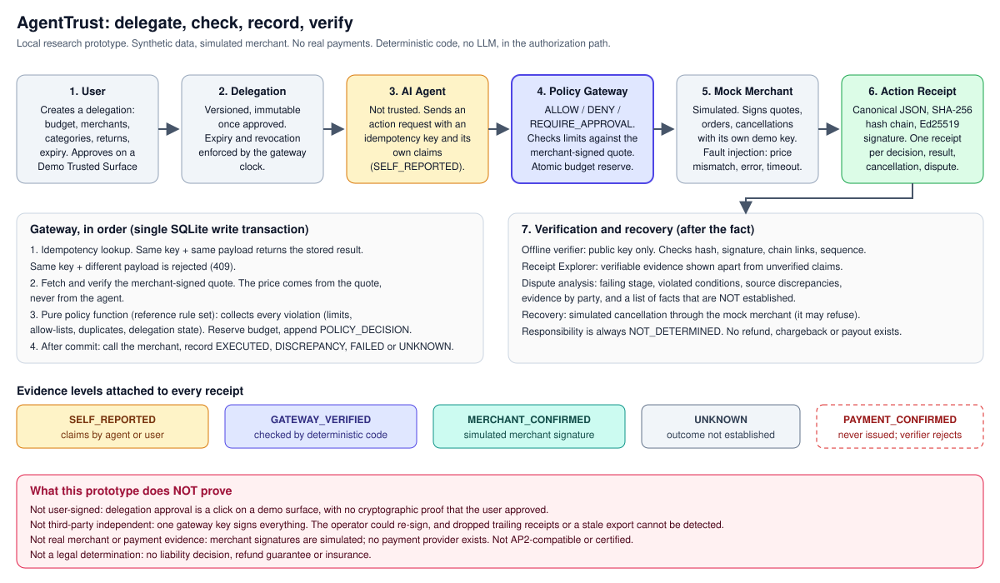
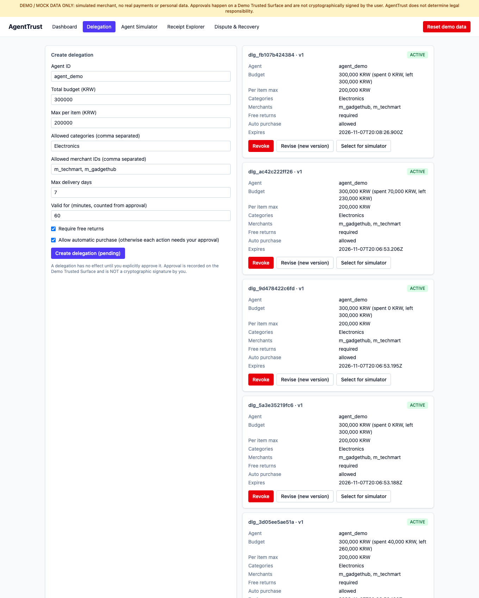
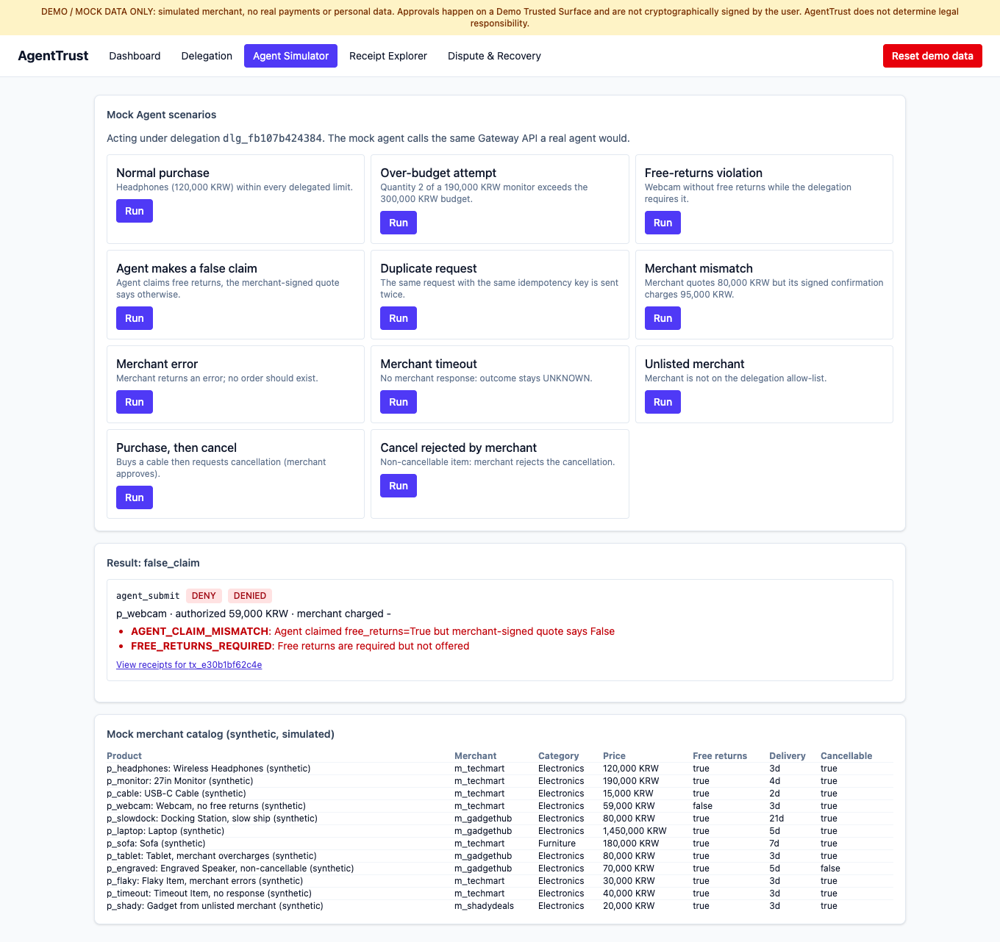
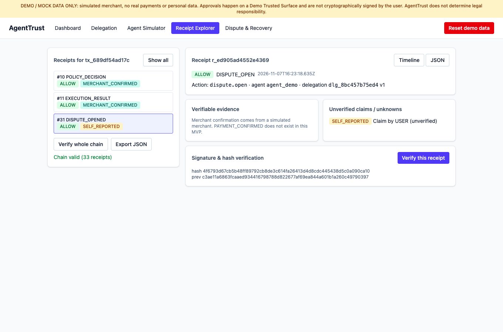
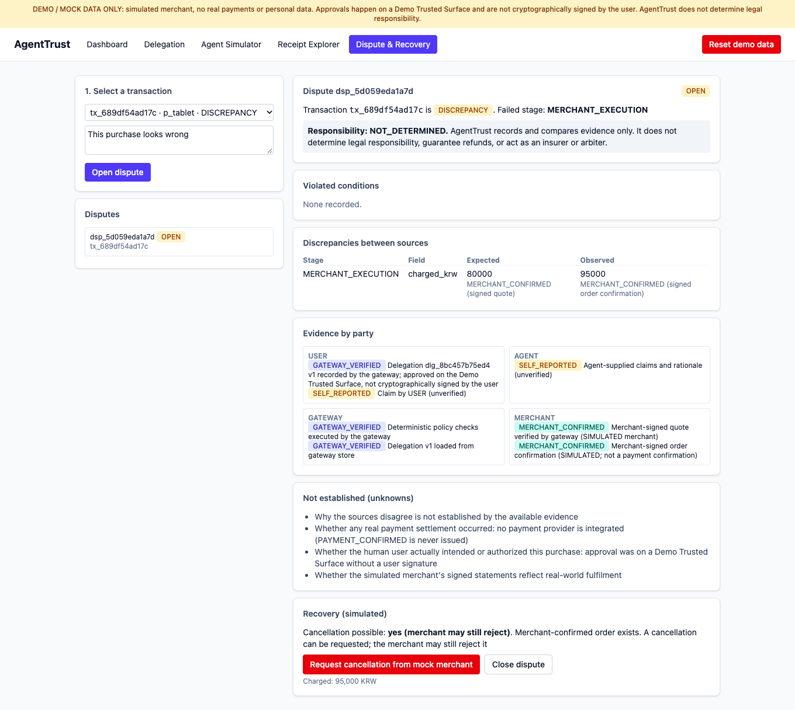

[English](README.md) · **한국어**

# AgentTrust

AI 에이전트의 행동을 검증·기록·복구하는 **독립형 AI Agent Trust Layer(AATL)** 입니다. 연구용 프로토타입입니다.

> **로컬 연구용 프로토타입입니다. 모든 데이터는 가상이며 판매자는 시뮬레이션입니다. 실제 결제·카드·개인정보·보험은 없습니다. 운영 환경용이 아니며, 법률 자문이 아니고, 법적 책임을 판정하지 않습니다.**

AI 에이전트가 대신 구매하거나 예약할 때, 세 주체는 각자 자기 쪽 이야기만 갖고 있습니다.

| 주체 | 문제 |
|---|---|
| **사용자** | 매 단계를 승인하지 않고도 위임하고 싶고, 에이전트가 *왜* 그렇게 행동했는지 확인하고 실수를 되돌리고 싶습니다. |
| **에이전트 제공자** | 프롬프트·모델·워크플로를 노출하지 않으면서, 에이전트가 사용자가 허용한 범위 안에 머물렀음을 보이고 싶습니다. |
| **판매자** | 정상 구매와 무단 구매를 구분하고, 분쟁 시 검증 가능한 증거를 갖고 싶습니다. |

AgentTrust는 이들 사이에 놓입니다: **사용자 → 위임 → AI 에이전트 → 독립 정책 게이트웨이 → (Mock) 판매자 → 행동 영수증 → 검증·복구 대시보드.**

## 아키텍처



에이전트는 신뢰하지 않는 대상으로 취급합니다. 게이트웨이의 결정적 검사와 서명된 진술만 증거로 인정되며, 에이전트나 사용자가 단지 *말한* 것은 모두 `SELF_REPORTED`로 표시됩니다.

## 화면 (실행 중인 데모, 가상 데이터)

| 위임 | 에이전트 시뮬레이터 |
|---|---|
|  |  |
| **영수증 탐색기** | **분쟁 및 복구** |
|  |  |

> 화면 UI는 영어입니다. 한국어 화면 캡처는 [agent-audit-trail](https://github.com/sihunwang-skala/agent-audit-trail)에 있습니다.

## 기능

- **위임 관리자**: 명시적 생성 → 승인, 버전 관리, 승인 후 불변, 만료·철회 강제.
- **독립 정책 게이트웨이**: 결정적 코드(LLM 없음)가 `ALLOW` / `DENY` / `REQUIRE_APPROVAL`을 반환합니다. 위임 유효성, 에이전트 신원, 판매자·카테고리 허용 목록, 품목당 한도, 남은 예산, 무료 반품, 배송 기한, 중복, 그리고 **판매자 서명 견적** 대비 에이전트 주장을 검사합니다. 예산 예약, 멱등성, 영수증 체인 추가는 원자적입니다(SQLite `BEGIN IMMEDIATE`).
- **행동 영수증**: 구조화, canonical JSON, SHA-256 해시 체인, Ed25519 서명. 타임라인 또는 JSON으로 볼 수 있습니다.
- **증거 수준**: `SELF_REPORTED`, `GATEWAY_VERIFIED`, `MERCHANT_CONFIRMED`(시뮬레이션된 판매자 서명), `UNKNOWN`. `PAYMENT_CONFIRMED`는 개념상 정의되어 있지만 여기서는 **절대 발급되지 않습니다**.
- **오프라인 검증기** (`verifier/agenttrust_verify.py`): 공개 키만으로 해시·서명·체인을 검사합니다.
- **복구·분쟁**: 주체별 증거를 비교하고, 실패한 단계를 찾고, 위반 조건과 *알 수 없는* 사실을 나열하며, Mock 판매자를 통해 취소를 시뮬레이션합니다. 책임은 항상 `NOT_DETERMINED`입니다. 취소 요청·승인·거절·상태 변경은 각각 별도 영수증입니다. 환불·차지백·지급은 없습니다.
- **웹 UI** (React + TS + Tailwind): 대시보드, 위임, 에이전트 시뮬레이터(11개 시나리오), 영수증 탐색기, 분쟁·복구.

## 테스트 범위

백엔드 테스트 70개(pytest)와 UI 테스트 4개(vitest). 적대적 시나리오는 [`backend/tests/test_adversarial.py`](backend/tests/test_adversarial.py)에 있습니다.

| 시나리오 | 기대 결과 | 상태 |
|---|---|---|
| 영수증 수정 (해시만 / 해시 재계산) | `HASH_MISMATCH` / `BAD_SIGNATURE` | 테스트됨 |
| 중간 영수증 삭제, 순서 변경, 중복, 서명 이식 | 체인·순번·서명 실패 | 테스트됨 |
| 증거 수준 부풀리기 (예: `MERCHANT_CONFIRMED`, `PAYMENT_CONFIRMED`) | 거부 | 테스트됨 |
| 같은 멱등성 키 재전송 / 다른 페이로드로 재사용 | 1회만 실행 / `409` | 테스트됨 |
| 승인·취소 재전송 | 2차 실행 없음, 예산 이중 해제 없음 | 테스트됨 |
| 하나의 예산에 대한 동시 요청 | 예산 초과 없음 | 테스트됨 |
| 오프라인 검증기에 대한 잘못된·악의적 입력 | 문제를 보고하고 중단되지 않음 | 테스트됨 |
| **최신 영수증 삭제 또는 이전의 정상 내보내기 재전송** | **탐지 불가** (알려진 한계, `test_known_limit_*`로 단언) | 미해결 |

## 빠른 시작

요구 사항: Python 3.11+, Node 20+ (또는 Docker).

```bash
# 백엔드
cd backend && python3 -m venv .venv && .venv/bin/pip install -r requirements-dev.txt
AGENTTRUST_ALLOW_DEMO_RESET=true .venv/bin/uvicorn app.main:default_app --factory --host 127.0.0.1 --port 8000
```
```bash
# 프런트엔드 (두 번째 터미널)
cd frontend && npm ci && npm run dev    # http://localhost:5173
```
```bash
# 또는 Docker로 한 번에
docker compose up --build
```
테스트: `cd backend && .venv/bin/python -m pytest -q`, `cd frontend && npm test`. API 문서는 `http://127.0.0.1:8000/docs`([API.md](API.md)도 참고). 데모 안내: [DEMO.md](DEMO.md).

커밋된 샘플의 오프라인 검증:
```bash
python verifier/agenttrust_verify.py samples/sample_export.json --public-key samples/gateway_public_key.hex --merchant-public-key samples/mock_merchant_public_key.hex
```

## 솔직한 한계

- 위임 승인은 **Demo Trusted Surface** 위의 클릭일 뿐이며, **사용자가 서명했다는 암호학적 증명은 없습니다**.
- 해시 체인과 단일 서버 서명은 키가 없는 사람의 *변조*를 탐지하지만, 기록이 완전하다는 것(마지막 영수증 삭제 가능)이나 서명자가 정직하다는 것을 증명하지 못하며, 제3자 독립성도 없습니다. 외부 타임스탬프와 독립 증인을 위한 확장 지점은 [ARCHITECTURE.md](ARCHITECTURE.md)에 설명되어 있습니다.
- Mock 판매자의 서명은 실제 판매자 증명이 아닌 **시뮬레이션 증거**입니다.
- "독립적으로 감사 가능"은 "독립적으로 보증됨"이 아닙니다. 공개 키로 누구나 영수증을 재검증할 수 있지만 서명 키는 같은 운영자가 갖고 있습니다. 어떤 제3자도 여기서 무언가를 증명한 바 없습니다.
- 인증, 속도 제한, 테넌트 격리가 없으므로 localhost에만 바인딩하세요. [SECURITY.md](SECURITY.md)를 참고하세요.
- Docker Compose와 GitHub Actions 워크플로는 제공되지만 마지막 검증에서는 실행해 보지 않았습니다.

## AP2 및 기타 표준과의 관계

Google의 [Agent Payments Protocol (AP2)](https://github.com/google-agentic-commerce/AP2)은 신뢰 화면에서의 사용자 승인 *mandate*와 에이전트 권한에 대한 서명 영수증을 설명합니다. AgentTrust는 그 *개념*(신뢰 화면에서 위임 → 제약 안에서 에이전트 행동 → 서명 영수증)을 차용하지만, **AP2 사양을 구현하지 않으며, AP2와 호환되거나 인증받지 않았고, Google 또는 AP2 프로젝트와 관련이 없습니다.** 초점이 다릅니다: 독립 게이트웨이, 증거 수준 분리, 분쟁 복구입니다. AP2 mandate 매핑은 향후 과제입니다([ROADMAP.md](ROADMAP.md)).

## 구조

```
backend/   FastAPI 앱, SQLAlchemy 모델, 테스트, 샘플 생성기
frontend/  React + Vite + Tailwind UI, vitest 테스트
verifier/  독립 실행형 오프라인 검증기 (`cryptography`에만 의존)
samples/   가상 서명 영수증 + 공개 키
docs/      아키텍처 다이어그램과 UI 스크린샷
```

## 저작권 및 이용 안내

저작권 © 2026 Sihun Wang. 모든 권리 보유.

이 프로젝트는 열람 및 포트폴리오 시연 목적으로 공개됩니다.

원본 소스 코드, 문서, 디자인 및 프로젝트 고유 자산에 대한 모든 권리는 저작자에게 있습니다.

관련 법령 또는 GitHub 이용약관이 허용하는 범위를 제외하고, 저작자의 사전 서면 허락 없이 원본 자료를 복제, 수정, 재배포하거나 상업적으로 이용할 수 없습니다.

제3자 라이브러리, 의존성 및 외부에서 가져온 자료는 각각의 라이선스와 소유권에 따릅니다([LICENSE_NOTICES.md](LICENSE_NOTICES.md) 참조).

라이선스, 협업 또는 상업적 문의는 저장소 소유자에게 연락해 주십시오.
