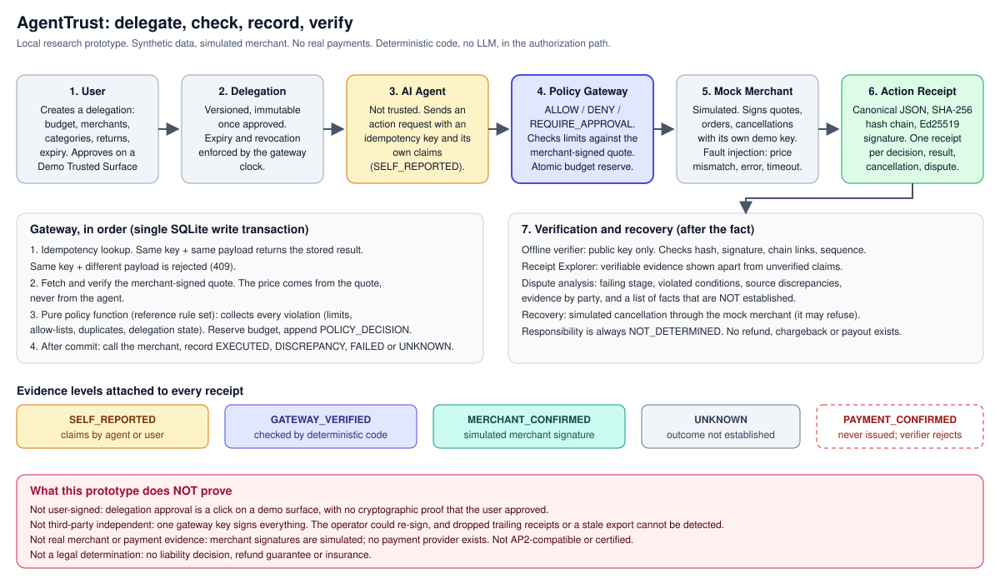
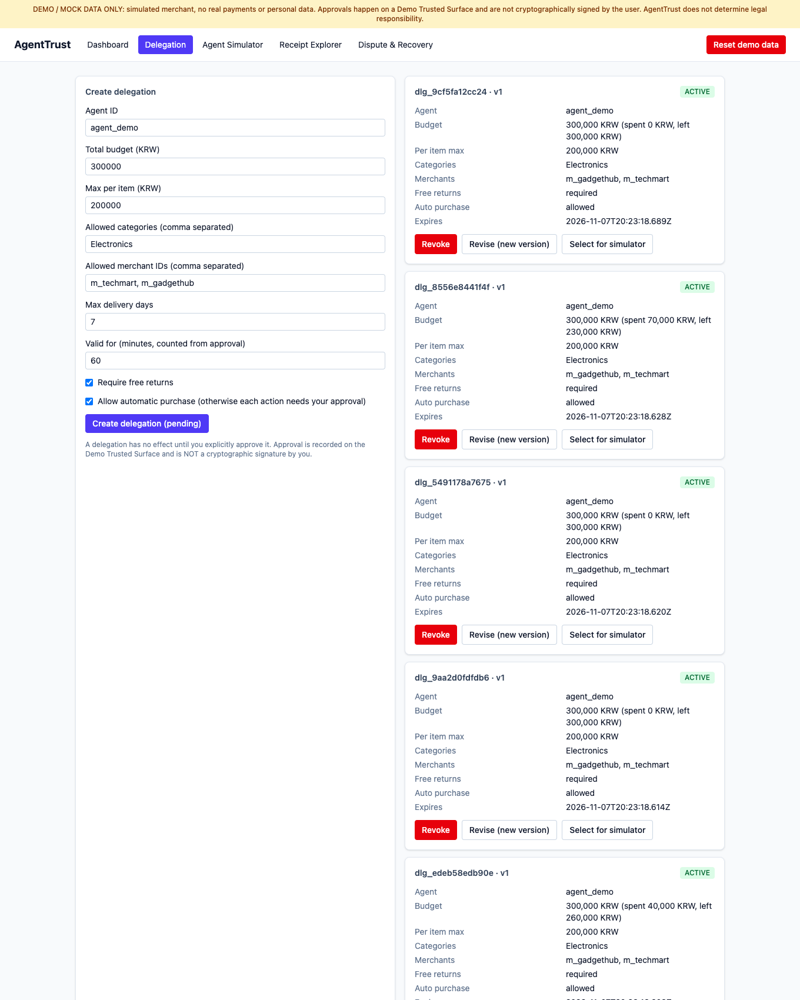
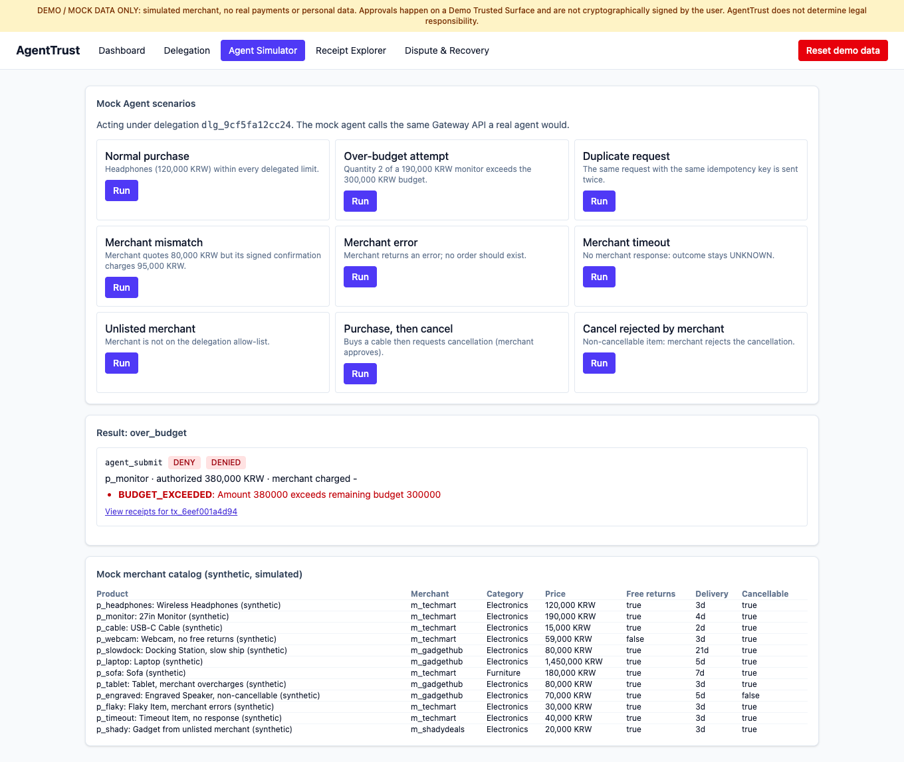
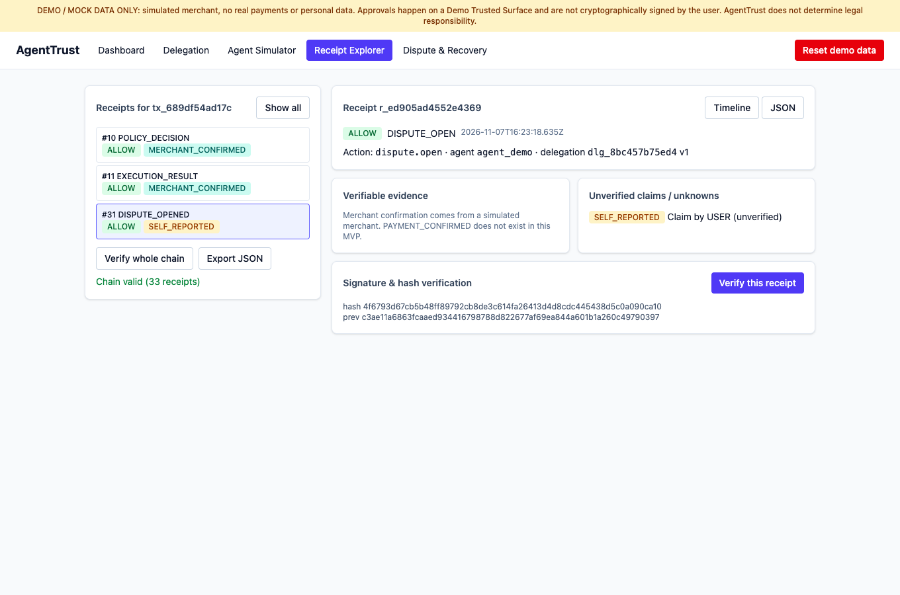
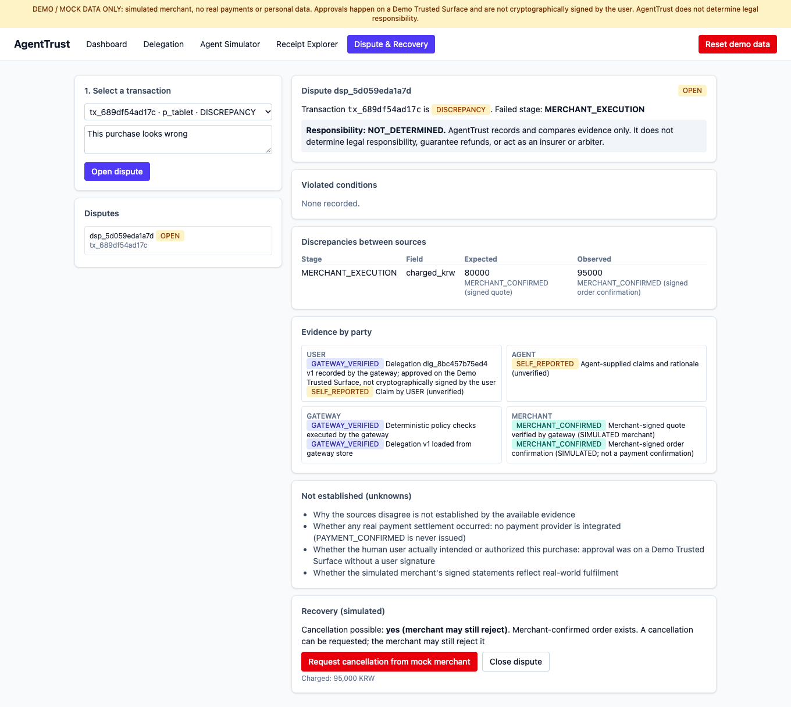

# AgentTrust

**An independent AI Agent Trust Layer (AATL)** for verifying, recording and recovering AI agent actions. Research prototype.

> **Local research prototype. All data is synthetic. The merchant is simulated. No real payments, cards, personal data or insurance. Not for production, not legal advice, and not a legal-responsibility decision-maker.**

When an AI agent buys or books something for you, three parties each hold only their own story:

| Party | Problem |
|---|---|
| **User** | Wants delegation without approving every step, plus a way to see *why* the agent acted and to undo mistakes. |
| **Agent provider** | Wants to show the agent stayed inside what the user allowed, without exposing prompts, models or workflows. |
| **Merchant** | Wants to tell legitimate purchases from unauthorized ones and have verifiable evidence in a dispute. |

AgentTrust sits between them: **User → Delegation → AI Agent → Independent Policy Gateway → (Mock) Merchant → Action Receipt → Verification & Recovery dashboard.**

## Architecture



The agent is treated as untrusted. Only the gateway's deterministic checks and signed statements count as evidence; everything the agent or user merely *says* stays labelled `SELF_REPORTED`.

## Screens (running demo, synthetic data)

| Delegation | Agent Simulator |
|---|---|
|  |  |
| **Receipt Explorer** | **Dispute & Recovery** |
|  |  |

## Public reference edition

This repository is the **public, portfolio edition**. It contains a complete working demo (gateway, receipts, offline verifier, UI) with a deliberately **simplified reference rule set and dispute analysis**. A fuller implementation exists outside this repository and is not published. Consequences you should know about:

- Delegations still store `require_free_returns` and `max_delivery_days`, but this edition does **not enforce** them.
- Agent-supplied `claimed` values are recorded as `SELF_REPORTED` evidence but are not cross-checked against the signed quote here.
- Dispute analysis is simpler than a production analysis would be.

## What it does

- **Delegation Manager**: explicit create → approve, versioned and immutable once approved; expiry and revocation enforced.
- **Independent Policy Gateway**: deterministic code (no LLM) returns `ALLOW` / `DENY` / `REQUIRE_APPROVAL`. The public reference rule set checks delegation validity, agent identity, merchant and category allow-lists, per-item limit, remaining budget and duplicates, using the price from a **merchant-signed quote**. Budget reservation, idempotency and receipt-chain append are atomic (SQLite `BEGIN IMMEDIATE`).
- **Action Receipts**: structured, canonical-JSON, SHA-256 hash-chained, Ed25519-signed. Viewable as timeline or JSON.
- **Evidence levels**: `SELF_REPORTED`, `GATEWAY_VERIFIED`, `MERCHANT_CONFIRMED` (simulated merchant signature), `UNKNOWN`. `PAYMENT_CONFIRMED` is defined by the concept but **never issued** here.
- **Offline verifier** (`verifier/agenttrust_verify.py`): checks hashes, signatures and chain with only a public key.
- **Recovery & disputes**: compares evidence per party, locates the failing stage, lists violated conditions and *unknown* facts, simulates cancellation through the mock merchant. Responsibility is always `NOT_DETERMINED`. Cancel request/approval/rejection/state change are separate receipts. No refund, chargeback or payout exists.
- **Web UI** (React + TS + Tailwind): Dashboard, Delegation, Agent Simulator (9 scenarios), Receipt Explorer, Dispute & Recovery.

## What is tested

67 backend tests (pytest) and 4 UI tests (vitest). Adversarial scenarios live in [`backend/tests/test_adversarial.py`](backend/tests/test_adversarial.py).

| Scenario | Expected result | Status |
|---|---|---|
| Edited receipt (hash only / hash recomputed) | `HASH_MISMATCH` / `BAD_SIGNATURE` | tested |
| Receipt deleted from the middle, reordered, duplicated, signature transplanted | chain / sequence / signature failure | tested |
| Evidence level inflated (e.g. to `MERCHANT_CONFIRMED`, `PAYMENT_CONFIRMED`) | rejected | tested |
| Same idempotency key replayed / reused with a different payload | executed once / `409` | tested |
| Replayed approval or cancellation | no second execution, no double budget release | tested |
| Concurrent requests against one budget | budget never exceeded | tested |
| Malformed or hostile input to the offline verifier | reports problems, never crashes | tested |
| **Newest receipts dropped, or an older genuine export replayed** | **not detected** (known limit, asserted by `test_known_limit_*`) | open |

## Quick start

Requirements: Python 3.11+, Node 20+ (or Docker).

```bash
# backend
cd backend && python3 -m venv .venv && .venv/bin/pip install -r requirements-dev.txt
AGENTTRUST_ALLOW_DEMO_RESET=true .venv/bin/uvicorn app.main:default_app --factory --host 127.0.0.1 --port 8000
```
```bash
# frontend (second terminal)
cd frontend && npm ci && npm run dev    # http://localhost:5173
```
```bash
# or everything with Docker
docker compose up --build
```
Tests: `cd backend && .venv/bin/python -m pytest -q` and `cd frontend && npm test`. API docs at `http://127.0.0.1:8000/docs` (see also [API.md](API.md)). Walkthrough: [DEMO.md](DEMO.md).

Offline verification of the committed sample:
```bash
python verifier/agenttrust_verify.py samples/sample_export.json --public-key samples/gateway_public_key.hex --merchant-public-key samples/mock_merchant_public_key.hex
```

## Honest limits

- The delegation approval is a click on a **Demo Trusted Surface**. There is **no cryptographic proof that the user signed it**.
- A hash chain plus a single server signature detects *alteration* by anyone without the key, but **cannot** prove the record is complete (trailing receipts could be dropped), cannot prove the signer is honest, and is not third-party independent. Extension points for external timestamping and independent witnesses are described in [ARCHITECTURE.md](ARCHITECTURE.md).
- The Mock Merchant's signatures are **simulation evidence**, not real merchant attestations.
- "Independently auditable" is not "independently assured": anyone can re-check a receipt with the public key, but the same operator holds the signing key. No third party has attested to anything here.
- No authentication, rate limiting or tenant isolation: bind to localhost only. See [SECURITY.md](SECURITY.md).
- Docker Compose and the GitHub Actions workflow are provided but were not exercised in the last verification pass.

## Relationship to AP2 and other standards

Google's [Agent Payments Protocol (AP2)](https://github.com/google-agentic-commerce/AP2) describes user-approved *mandates* on a trusted surface and signed receipts for agent authorization. AgentTrust borrows that *concept* (delegate on a trusted surface → agent acts within constraints → signed receipt) but **implements none of the AP2 specification, is not AP2-compatible, certified, or affiliated with Google or the AP2 project**. Its focus differs: an independent gateway, evidence-level separation and dispute recovery. Mapping to AP2 mandates is future work ([ROADMAP.md](ROADMAP.md)).

## Layout

```
backend/   FastAPI app, SQLAlchemy models, tests, sample generator
frontend/  React + Vite + Tailwind UI, vitest tests
verifier/  standalone offline verifier (depends only on `cryptography`)
samples/   synthetic signed receipts + public keys
docs/      architecture diagram and UI screenshots
```

## Copyright & Usage

Copyright © 2026 Sihun Wang. All Rights Reserved.

This project is publicly available for viewing and portfolio demonstration purposes.

All rights to the original source code, documentation, designs, and project-specific assets are reserved by the author.

No permission is granted to reproduce, modify, redistribute, or commercially use the original materials without prior written authorization, except as permitted by applicable law or GitHub's Terms of Service.

Third-party libraries, dependencies, and other externally sourced materials remain subject to their respective licenses and ownership rights (see [LICENSE_NOTICES.md](LICENSE_NOTICES.md)).

For licensing, collaboration, or commercial inquiries, please contact the repository owner.

## 저작권 및 이용 안내

저작권 © 2026 Sihun Wang. 모든 권리 보유.

이 프로젝트는 열람 및 포트폴리오 시연 목적으로 공개됩니다.

원본 소스 코드, 문서, 디자인 및 프로젝트 고유 자산에 대한 모든 권리는 저작자에게 있습니다.

관련 법령 또는 GitHub 이용약관이 허용하는 범위를 제외하고, 저작자의 사전 서면 허락 없이 원본 자료를 복제, 수정, 재배포하거나 상업적으로 이용할 수 없습니다.

제3자 라이브러리, 의존성 및 외부에서 가져온 자료는 각각의 라이선스와 소유권에 따릅니다([LICENSE_NOTICES.md](LICENSE_NOTICES.md) 참조).

라이선스, 협업 또는 상업적 문의는 저장소 소유자에게 연락해 주십시오.
